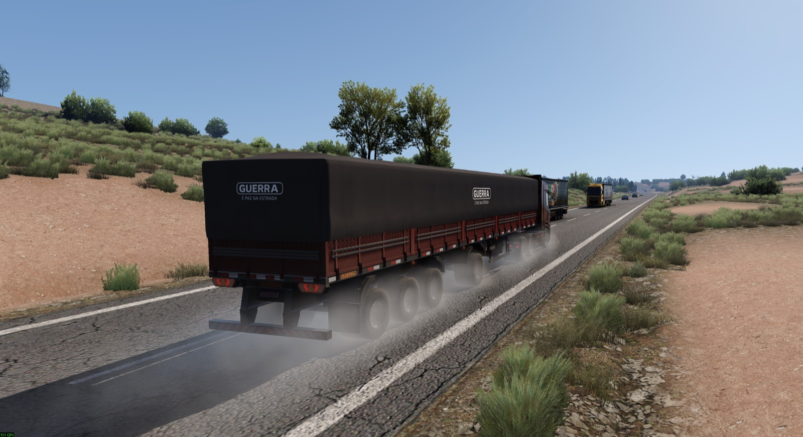

# Brake Fade for ETS2 & ATS

[English](#english) · [Português (Brasil)](#português-brasil)

On long descents, repeated use of the service brakes heats them up. **Brake Fade** simulates the loss of stopping power and its recovery as the brakes cool. Watch the temperature and remaining braking efficiency of your truck and each attached trailer on the HUD.

**Compatibility:** Euro Truck Simulator 2 **1.62.3.3** tested in-game. American Truck Simulator **1.62.2.2** has confirmed trailer brake smoke. Native service-brake fade is available in ETS2. 64-bit Windows, DirectX 11, single player.

**[Download Brake Fade / Baixar Brake Fade (ZIP)](https://github.com/Rhaiderr/ets2-ats-brake-fade/releases/latest/download/ets2-ats-brake-fade.zip)** · [Release notes / Notas](https://github.com/Rhaiderr/ets2-ats-brake-fade/releases/latest) · [Installation](#installation-and-controls) · [Mod Hub](https://rhaiderr.github.io/mod-hub/#brake-fade)

## In-game screenshots · Capturas do jogo

*In-game capture from ETS2 showing smoke at the wheels of a Guerra trailer. / Captura do ETS2 com fumaça nas rodas de uma carreta Guerra.*

On your next ETS2 descent, keep the HUD visible and watch how temperature and braking efficiency change as you use the service brakes.

Na próxima descida no ETS2, deixe o HUD visível e acompanhe como a temperatura e a eficiência mudam ao usar o freio de serviço.

## English

### Compatibility

- **Euro Truck Simulator 2 1.62.3.3 x64** — Windows, DirectX 11, single player. Native service-brake fade and trailer smoke were confirmed in-game.
- **American Truck Simulator 1.62.2.2 x64** — trailer brake smoke confirmed in-game in v0.4.1. Native service-brake fade is available in ETS2.
- The installer checks the exact game executable. Other builds may require an update to the plugin.

### Installation and controls

1. Close the game and extract the complete ZIP.
2. Run `install.bat` for ETS2. For ATS, run `install.bat -Game ATS`. For a custom Steam library, add `-GamePlugins "…\bin\win_x64\plugins"`.
3. Confirm the displayed destination. The installer backs up an existing Brake Fade DLL and INI and preserves your active settings. Disable any other brake plugin before installing.
4. Start the game. Press **Shift+F12** to open the plugins menu and **Shift+F9** to hide or show the fixed HUD (on by default). Keep your usual keyboard or pedal bindings in ETS2.

Use the settings panel to adjust heating, cooling, the fade curve, smoke, alerts and HUD size and position. The default preset starts fade at 300 °C and reaches 25% remaining efficiency at 600 °C; smoke starts at 350 °C and peaks at 500 °C. **Restore defaults** resets this plugin only; **Realistic preset** resets every installed plugin (keys and saved state are kept). Click **Apply** to save the changes of every tab. The **Mod Hub** tab lists the plugins and mods and points out updates; updates are always downloaded by hand from the site. Optional sound requires local PCM16 WAV files at `sounds/BrakeFadeBR/brake_low.wav` and `sounds/BrakeFadeBR/brake_high.wav` beside the DLL.

To uninstall, close the game and remove `brake_fade_br.dll` from `bin/win_x64/plugins`. To roll back, restore the previous files from `plugins/backups/BrakeFadeBR/`.

## Português (Brasil)

Numa descida longa, o uso repetido do freio de serviço aquece os freios. O **Brake Fade** simula a perda de força de frenagem e a recuperação conforme os freios esfriam. Acompanhe no HUD a temperatura e a eficiência restante do caminhão e de cada carreta engatada.

**Compatibilidade:** Euro Truck Simulator 2 **1.62.3.3** testado em jogo. American Truck Simulator **1.62.2.2** com fumaça dos freios da carreta confirmada em jogo. A perda de eficiência no freio de serviço nativo está disponível no ETS2. Windows de 64 bits, DirectX 11 e modo individual.

[Baixar Brake Fade (ZIP)](https://github.com/Rhaiderr/ets2-ats-brake-fade/releases/latest/download/ets2-ats-brake-fade.zip) · [Ver instalação](#instalação-e-atalhos)

### Compatibilidade

- **Euro Truck Simulator 2 1.62.3.3 x64** — Windows, DirectX 11, modo individual. A perda de eficiência no freio de serviço e a fumaça da carreta foram confirmadas no jogo.
- **American Truck Simulator 1.62.2.2 x64** — fumaça dos freios da carreta confirmada em jogo na v0.4.1. A perda de eficiência no freio de serviço nativo está disponível no ETS2.
- O instalador confere o executável exato. Outras versões podem precisar de uma atualização do plugin.

### Instalação e atalhos

1. Feche o jogo e extraia o ZIP completo.
2. Execute `install.bat` para ETS2. Para o ATS, execute `install.bat -Game ATS`. Se a biblioteca da Steam estiver em outra pasta, acrescente `-GamePlugins "…\bin\win_x64\plugins"`.
3. Confira o destino mostrado. O instalador faz backup da DLL e do INI anteriores e preserva suas configurações. Desative outros plugins de freio antes de instalar.
4. Abra o jogo. Use **Shift+F12** para abrir o menu dos plugins e **Shift+F9** para ocultar ou mostrar o HUD fixo (ligado por padrão). Mantenha os controles de teclado ou pedal que você já usa no ETS2.

No menu, ajuste aquecimento, resfriamento, curva de perda de eficiência, fumaça, avisos, tamanho e posição do HUD. O preset padrão começa a reduzir a eficiência a 300 °C e chega a 25% de eficiência restante a 600 °C; a fumaça começa a 350 °C e chega ao máximo a 500 °C. **Restaurar padrões** reseta só este plugin; **Preset realista** reseta todos os plugins instalados (teclas e estado salvo são mantidos). **Aplicar** salva as alterações de todas as abas. A aba **Mod Hub** lista os plugins e mods e avisa quando há atualização; a atualização é sempre baixada manualmente pelo site. O áudio opcional precisa dos WAVs PCM16 locais `sounds/BrakeFadeBR/brake_low.wav` e `sounds/BrakeFadeBR/brake_high.wav` ao lado da DLL.

Para desinstalar, feche o jogo e remova `brake_fade_br.dll` de `bin/win_x64/plugins`. Para voltar à versão anterior, restaure os arquivos de `plugins/backups/BrakeFadeBR/`.

## More mods and support · Mais mods e apoio

[Truck Dirt](https://github.com/Rhaiderr/ets2-truck-dirt) · [Tire Wear](https://github.com/Rhaiderr/ets2-tire-wear)

*Brake Fade promotional artwork / Arte promocional do Brake Fade.*

[Buy Me a Coffee / Apoie o projeto](https://buymeacoffee.com/leonardoarouck)
